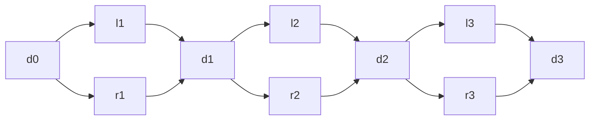
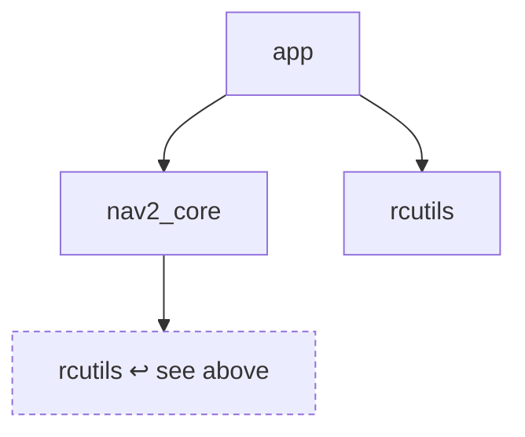
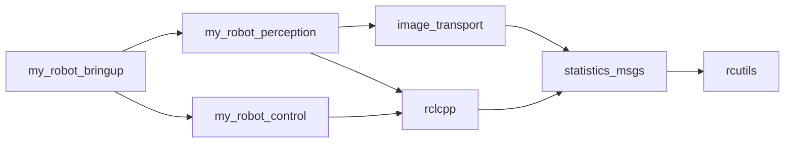
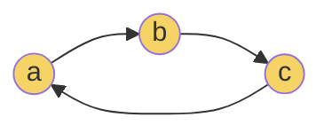

# How the algorithms work

rostree is a small program built on a handful of classic graph algorithms. None of
them is new; what matters is picking the right one for a ROS workspace and getting
the details right. This page explains each one from scratch, for someone who has
used a ROS workspace but never thought hard about the graph underneath it.

Every section has the same shape: the question, why the obvious approach fails,
the idea that fixes it, the steps, what it costs, where it lives in the code, and a
few lines you can run to watch it work.

!!! tip "Reading the cost lines"
    *V* is the number of packages and *E* the number of dependency edges between
    them. "Linear" — *O(V + E)* — means doubling the workspace roughly doubles the
    work. That is the best a program that has to look at every package can do.

---

## 1. A dependency "tree" is not a tree

**The question.** What does a package depend on — all the way down?

**The obvious approach.** Read the package's `package.xml`, print each dependency,
then do the same for each of those, indenting as you go. That is what "dependency
tree" suggests, and what rostree did before 0.3.

**Why it fails.** A tree has exactly one path from the root to each node. A ROS
dependency graph does not: `rcutils` sits under `rclcpp`, under `rcl`, under
`rosidl_runtime_c` and under a dozen more. The graph is a **DAG** — a *directed
acyclic graph*, a structure where many paths can lead to the same node. Print it
as if it were a tree and every one of those paths gets printed in full.

The smallest picture of the problem is a *diamond*: two packages that depend on
the same third one.



Each diamond doubles the number of paths to everything below it. A chain of *k*
diamonds has 3*k* + 1 packages, but printing every path takes
2<sup>*k* + 2</sup> − 3 lines. Those numbers are not from a derivation alone —
they are what `rostree tree --full` prints on generated diamond chains:

| diamonds *k* | packages | every path printed (`--full`) | each package once (default) |
|---:|---:|---:|---:|
| 3 | 10 | 29 | 13 |
| 5 | 16 | 125 | 21 |
| 8 | 25 | 1,021 | 33 |
| 10 | 31 | 4,093 | 41 |

The default column grows by four lines per diamond; the `--full` column doubles.
On a real 146-package workspace, the same effect turned one package's tree into
60,981 lines and 7 seconds — and on deeper workspaces it never finished at all.

---

## 2. Expand once, reference after

**The idea.** Print each package's subtree **once**, at the first place it
appears. Everywhere else, print its name with a marker — `↩ see above` — instead
of its children. This is what `cargo tree` does with `(*)`.

**The steps.** A depth-first walk, which is also the order the tree is printed in,
carrying one set of packages already expanded:

1. Visit a package. If it is on the *current path* (an ancestor of itself), it is
   a cycle: mark it `⟳` and stop.
2. If it is already in the *expanded* set, mark it `↩ see above` and stop.
3. Otherwise add it to the set, then visit each of its dependencies in the order
   the manifest declares them.



**The detail that matters.** "First" has to mean *first printed*, not *closest to
the root*. Both sound reasonable, and the second is what a breadth-first walk
gives you for free. But the tree is printed depth-first, so the shallowest copy
of a package can be printed *below* a deeper one — and then "see above" points at
something the reader has not seen yet. The 0.3 rewrite first chose expansion by
distance and hit exactly that; it was fixed before release by keying expansion
off the same depth-first order the printer uses, which makes "see above" true by
construction.

A depth limit adds one more subtlety: a package cut off by `--depth` is **not**
counted as expanded, so a later occurrence that has room to expand still shows
its full subtree.

**Cost.** Each package is expanded once and each edge followed once: *O(V + E)*.

**In the code.** `_TreeBuilder` in
[`core/tree.py`](https://github.com/guilyx/rostree/blob/main/src/rostree/core/tree.py).

**Try it.**

```python
from rostree.api import build_tree, tree_stats

root = build_tree("my_robot_bringup", runtime_only=True)
tree_stats(root)    # {'nodes': 406, 'packages': 108, 'repeats': 240, ...}
root_full = build_tree("my_robot_bringup", collapse_repeats=False, max_depth=6)
```

---

## 3. Resolving the graph: breadth-first, once

**The question.** For graphs, checks and statistics you do not want a printable
tree at all — you want the graph itself: every package reachable from some
roots, and its edges.

**The idea.** A **breadth-first search** (BFS). Start from the roots, visit
everything one hop away, then everything two hops away, and so on. Each package
is resolved and parsed exactly once, however many paths lead to it.

**The steps.**

1. Put the roots in a queue at depth 0.
2. Take the next package. Look it up in the index; if there is no `package.xml`,
   record it as **missing** and move on.
3. Parse its manifest and record its edges.
4. For each dependency not yet seen, record its depth (one more than the current
   package's) and add it to the queue.

Because BFS visits packages in order of distance, the depth recorded for each one
is its **shortest distance** from any root — useful on its own, and the reason a
depth limit is easy to reason about.

**The depth limit and its frontier.** With `--depth N`, packages at depth *N* are
resolved but their dependencies are not walked. Those dependencies still appear as
edge targets, so rostree records them separately as **truncated**: present in the
graph, not looked at. They are *not* missing. Mixing the two up made the HTML
viewer label every package one hop past the limit "Unresolved" — a bug fixed
after 1.0.

**Cost.** *O(V + E)* — and memory for one queue and one set.

**In the code.** `build_dependency_graph` in
[`core/tree.py`](https://github.com/guilyx/rostree/blob/main/src/rostree/core/tree.py).

**Try it.**

```python
from rostree.api import build_graph

graph = build_graph("my_robot_bringup", max_depth=2)
graph.depths["rclcpp"]   # shortest distance from the root
graph.missing            # names with no package.xml anywhere
graph.truncated          # past the depth limit: real, just not walked
```

---

## 4. Why is this here? Every shortest path

**The question.** `rostree why my_robot_bringup rcutils` — through which chain of
packages does one end up depending on the other?

**Why not list every path.** Section 1 showed how fast the number of paths grows.
"All the ways A reaches B" is usually thousands of near-identical chains. The
question a person is actually asking is *how did this get pulled in*, and the
shortest chains answer it.

**The idea.** BFS again, from the first package, but remembering **every** parent
that reaches a node at its minimal depth — not just the first one found. Then walk
backwards from the target through those parents.

**The steps.**

1. BFS from the start. When a dependency is seen for the first time, record its
   depth and its parent. When it is seen *again at the same depth*, add the second
   parent too: that is another route of equal length.
2. Stop expanding once you are past the depth at which the target was found;
   nothing further can be shorter.
3. From the target, follow parents back to the start. Each way of doing so is one
   shortest path. Parents are visited in name order, so the output is stable.



Three shortest paths of length 4 lead from `my_robot_bringup` to `rcutils` above;
`why` prints all three and nothing longer.

**Cost.** One BFS, *O(V + E)*, plus the paths themselves (capped by `--limit`).

**In the code.** `shortest_paths` in
[`core/analysis.py`](https://github.com/guilyx/rostree/blob/main/src/rostree/core/analysis.py).
The HTML viewer's shift-click does the same thing in JavaScript.

**Try it.**

```python
from rostree.api import dependency_paths

dependency_paths("my_robot_bringup", "rcutils")
```

---

## 5. Who breaks if this changes? Reverse dependencies

**The question.** You are about to change `my_robot_msgs`. Which packages depend
on it, directly or through others?

**Why it is not just the tree backwards.** A `package.xml` lists what a package
*needs*; nothing lists what *needs it*. The only way to know is to read every
manifest you can see.

**The idea.** Invert the whole graph once: for every package and each of its
dependencies, record "dependency ← package". After that, "who depends on X" is a
lookup, and the transitive answer is a walk over the inverted edges.

**The steps.**

1. Parse every manifest in the index and build the map *dependency → dependents*.
   This is the slow part, so it is cached on the index and reused.
2. Direct dependents: one lookup.
3. Transitive dependents: a worklist. Start with the direct ones; for each name
   taken off the list, add its own dependents unless they were seen before.

**A deliberate exception to filtering.** Everywhere else in rostree, a package
removed by `--exclude` is also *not followed*. Here that would be wrong: if
`lib` depends on `my_robot_msgs` and `app` depends on `lib`, then `app` breaks
when the messages change, whether or not you excluded `lib` from the output. So
`rdeps` walks the full inverted graph and applies the filter to the *answer*.

**Cost.** Building the inverted map reads every manifest once: *O(V + E)*. Every
query after that is proportional to the answer.

**In the code.** `PackageIndex.reverse_dependencies` in
[`core/index.py`](https://github.com/guilyx/rostree/blob/main/src/rostree/core/index.py)
and `dependents` in
[`core/analysis.py`](https://github.com/guilyx/rostree/blob/main/src/rostree/core/analysis.py).

**Try it.**

```python
from rostree.api import reverse_dependencies

reverse_dependencies("my_robot_msgs", transitive=True)
```

---

## 6. Finding cycles: three colours

**The question.** Does any package depend, directly or indirectly, on itself?
ROS packages should not — a cycle makes a build order impossible — so
`rostree check` fails CI when it finds one.

**The idea.** A depth-first search that colours each package as it goes:

- **white** — not visited yet,
- **grey** — visit in progress: it is on the current path,
- **black** — finished: everything below it has been explored.

Reaching a **grey** package means you have come back to something still on your
own path. That edge closes a cycle, and the path from that package to here *is*
the cycle. Reaching a black one is harmless — it is just a shared dependency.



**Cost.** One DFS, *O(V + E)*.

**In the code.** `DependencyGraph.cycles` in
[`core/tree.py`](https://github.com/guilyx/rostree/blob/main/src/rostree/core/tree.py).
The HTML viewer uses the same colouring to find the edges it must not lay out
(next section).

**Try it.**

```python
from rostree.api import build_graph

build_graph("my_robot_bringup").cycles()   # [] when the graph is a DAG
```

---

## 7. Drawing a DAG that reads left to right

**The question.** How do you draw a dependency graph so a person can read it?

**Why not a force-directed layout.** The usual answer — treat nodes as charged
particles, edges as springs, and let it settle — ignores the one thing a
dependency graph has: **direction**. Dependencies end up on every side of the
package that needs them, and a large graph settles into a ball.

**The idea.** The **layered** (or *Sugiyama*) layout: put each package in a column
so that every arrow points the same way, then work on making the picture tidy.
rostree computes it inside the HTML page, in about 150 lines of JavaScript, so the
viewer needs no layout library and no network.

**The steps.**

1. **Layers by longest path.** Process packages in topological order (Kahn's
   algorithm: repeatedly take one whose predecessors are all placed). Each goes
   one column to the right of its *furthest-right* predecessor. Taking the
   longest path rather than the shortest guarantees that every edge points
   forward by at least one column, so nothing is drawn on top of its own
   dependency.
2. **Dummy nodes.** An edge that skips columns gets an invisible waypoint in each
   column it crosses. It is then routed around packages instead of through them,
   and the next step can untangle it like any other edge.
3. **Crossing reduction.** Within each column, sort the nodes by the **median**
   position of their neighbours in the column before; then sweep back the other
   way using the column after. Four down-and-up sweeps. Finding the order with
   the fewest crossings is NP-hard; the median heuristic is the standard, cheap,
   good-enough answer.
4. **Coordinates.** Columns are spaced by their widest label. Within a column,
   each node is nudged halfway toward the average height of its neighbours, three
   times in each direction, then pushed apart again wherever two overlap — so
   long straight runs come out straight.
5. **Cycles.** Edges that close a cycle (found with the colouring from section 6)
   are left out of steps 1–4 — they are what would make layering impossible — and
   drawn afterwards as curves.

The viewer never lays out the whole workspace at once. It lays out the
neighbourhood of the package you are looking at, up to the chosen depth, and
re-runs the layout each time you click.

**Cost.** Steps 1, 2 and 4 are linear in the drawn subgraph. Step 3 sorts each
column, so it is *O(n log n)* per sweep for a column of *n* nodes.

**In the code.** `computeLayout` in
[`web/graph.js`](https://github.com/guilyx/rostree/blob/main/src/rostree/web/graph.js).

**Try it.** `rostree graph my_robot_bringup -f html --open`, then click around:
each click is a fresh layout.

---

## 8. Reading `condition="..."` without `eval`

**The question.** A `package.xml` can say a dependency only applies sometimes:

```xml
<depend condition="$ROS_VERSION == 1">roscpp</depend>
<depend condition="$ROS_VERSION == 2">rclcpp</depend>
```

**The obvious approach, and why not.** These expressions look like Python, and
the reference implementation (catkin_pkg) builds a string from the operands and
calls `eval` on it. A manifest is text from a repository you may not control.
rostree never evaluates it as code.

**The idea.** A tiny **recursive-descent parser**: one function per rule of the
grammar, each calling the next, evaluating as it goes.

```text
expr      := and_expr ("or" and_expr)*        # lowest precedence
and_expr  := atom ("and" atom)*               # binds tighter than "or"
atom      := "(" expr ")" | term OP term
term      := $VARIABLE | value
OP        := == | != | >= | > | <= | <
```

Putting `and` one level below `or` is all it takes to give `and` the higher
precedence. Operands compare as **strings**; that is the upstream rule, and it
works because ROS distro names are alphabetical, so `$ROS_DISTRO >= humble` does
what it says. Anything that does not match the grammar is rejected — and the
dependency is then *kept*, because a tree one dependency too large is a smaller
mistake than one quietly missing a dependency.

**Cost.** Linear in the length of the condition.

**In the code.**
[`core/conditions.py`](https://github.com/guilyx/rostree/blob/main/src/rostree/core/conditions.py).

**Try it.**

```python
from rostree.core.conditions import evaluate_condition

evaluate_condition("$ROS_VERSION == 2 and $ROS_DISTRO >= humble",
                   {"ROS_VERSION": "2", "ROS_DISTRO": "jazzy"})   # True
```

---

## Further reading

- E. R. Gansner, E. Koutsofios, S. C. North and K.-P. Vo, *A Technique for Drawing
  Directed Graphs*, IEEE Transactions on Software Engineering, 1993 — the layered
  layout as Graphviz's `dot` implements it.
- K. Sugiyama, S. Tagawa and M. Toda, *Methods for Visual Understanding of
  Hierarchical System Structures*, IEEE Transactions on Systems, Man, and
  Cybernetics, 1981 — where the layered approach began.
- T. H. Cormen et al., *Introduction to Algorithms*, chapters on breadth-first
  search, depth-first search and topological sort.
- [REP 149](https://ros.org/reps/rep-0149.html) — package manifest format 3,
  including dependency conditions.

Want to build something with these? See [Build on rostree](extending.md).
